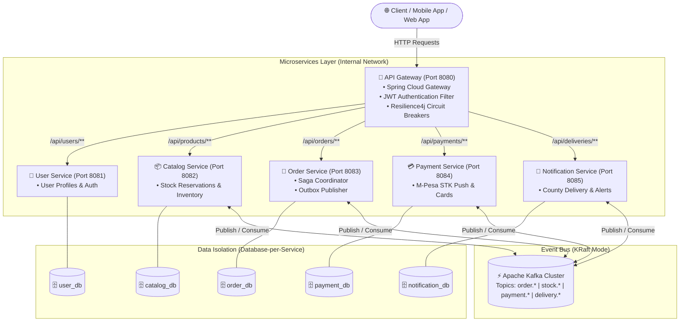
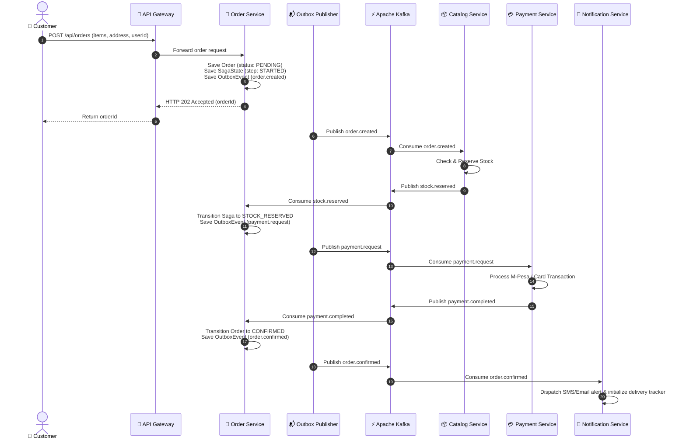
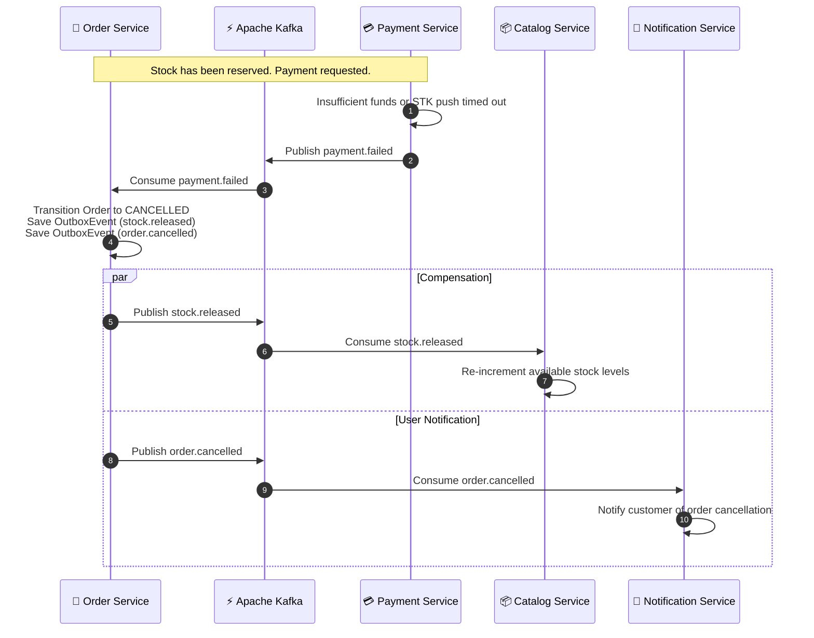

# Storefront Services

[](https://openjdk.org/projects/jdk/21/)
[](https://spring.io/projects/spring-boot)
[](https://spring.io/projects/spring-cloud)
[](https://kafka.apache.org/)
[](https://www.postgresql.org/)
[](https://docs.docker.com/compose/)
[](https://opensource.org/licenses/MIT)

> **Production-grade event-driven microservices architecture inspired by African e-commerce platforms (Jumia, Copia). Built with Java 21, Spring Boot 3, Apache Kafka, Spring Cloud Gateway with Resilience4j circuit breakers, and an orchestrated Saga checkout flow with compensating transactions.**

---

## Table of Contents

- [Architectural Overview](#architectural-overview)
- [System Architecture Diagram](#system-architecture-diagram)
- [Microservices Topology](#microservices-topology)
- [Distributed Saga Pattern](#distributed-saga-pattern)
- [Kafka Event Catalogue](#kafka-event-catalogue)
- [Reliability & Resilience Patterns](#reliability--resilience-patterns)
- [Quick Start & Setup Guide](#quick-start--setup-guide)
- [Testing Guide & Verification](#testing-guide--verification)
- [cURL End-to-End Walkthrough](#curl-end-to-end-walkthrough)
- [Project Structure](#project-structure)
- [CI/CD & Code Quality](#cicd--code-quality)
- [Contributing & License](#contributing--license)

---

## Architectural Overview

**Storefront Services** demonstrates modern distributed patterns designed for high-concurrency e-commerce operating in emerging markets:

* **Saga Orchestrator with Compensating Transactions**: End-to-end checkout coordination across Catalog, Payment, and Notification services ensuring eventual consistency without distributed locks.
* **Transactional Outbox Pattern**: Guarantees atomic DB state transitions and zero message loss by persisting events in relational tables before asynchronous Kafka dispatch.
* **Idempotent Message Processing**: Dedicated `processed_events` tracking prevents duplicate event execution on Kafka rebalances and retries.
* **Resilient API Gateway**: Single entry point with JWT validation, route-level Resilience4j Circuit Breakers (50% failure rate threshold, 10s open wait duration), and automatic HTTP 503 fallback routing.
* **Kenyan Fintech & Logistics Integration**: Simulated Safaricom M-Pesa STK push (Daraja API simulation), card payments with refund capabilities, and county-aware delivery milestone tracking (Nairobi, Kiambu, Mombasa, Kisumu, Nakuru, Eldoret).

---

## System Architecture Diagram



---

## Microservices Topology

| Service | Port | Database | Primary Responsibility |
| :--- | :---: | :--- | :--- |
| **`api-gateway`** | `8080` | *None* | Central reverse proxy, JWT claims extraction, route-level circuit breakers, fallback responses. |
| **`user-service`** | `8081` | `user_db` | User profiles, credential management, address book. |
| **`catalog-service`** | `8082` | `catalog_db` | Inventory levels, atomic stock reservation, stock release on order cancellation. |
| **`order-service`** | `8083` | `order_db` | Order lifecycle, Checkout Saga state engine, Transactional Outbox poller. |
| **`payment-service`** | `8084` | `payment_db` | M-Pesa STK Push simulation, Card payments, idempotent payment capture and refunds. |
| **`notification-service`** | `8085` | `notification_db` | Delivery milestones across Kenyan counties, SMS/Email dispatch simulation. |
| **`common-events`** | *N/A* | *None* | Shared immutable event schemas (`EventEnvelope`, payload DTOs, topic constants). |

---

## Distributed Saga Pattern

The checkout flow follows an orchestrated Saga coordinated by `OrderSagaOrchestrator` in `order-service`.

### 1. Happy Path Sequence



### 2. Compensating Transaction Flow (Payment Failure)



---

## Kafka Event Catalogue

All messages are wrapped in a generic `EventEnvelope<T>` containing `eventId`, `orderId`, `timestamp`, `eventType`, and typed `payload`.

| Topic Name | Producer Service | Consumer Service(s) | Payload Purpose |
| :--- | :--- | :--- | :--- |
| **`order.created`** | `order-service` | `catalog-service` | Notifies catalog to reserve requested stock quantities. |
| **`stock.reserved`** | `catalog-service` | `order-service` | Confirms inventory hold; triggers payment phase. |
| **`stock.reservation-failed`** | `catalog-service` | `order-service` | Signals out-of-stock; cancels the order immediately. |
| **`payment.completed`** | `payment-service` | `order-service`, `notification-service` | Confirms transaction success; triggers final order confirmation. |
| **`payment.failed`** | `payment-service` | `order-service`, `notification-service` | Triggers saga rollback compensation (releases stock). |
| **`stock.released`** | `order-service` | `catalog-service` | Compensating action restoring inventory after failed checkout. |
| **`order.confirmed`** | `order-service` | `notification-service` | Orders confirmed; schedules regional delivery dispatch. |
| **`order.cancelled`** | `order-service` | `notification-service` | Final cancellation notice dispatched to customer. |
| **`delivery.status-updated`** | `notification-service` | `order-service` | Updates order tracking milestones across distribution hubs. |

---

## Reliability & Resilience Patterns

1. **Transactional Outbox Pattern**:
   Relational writes and event generation occur within the same local ACID transaction. A background scheduler reads pending rows and publishes them to Kafka, guaranteeing *at-least-once* delivery.
2. **Idempotent Consumers**:
   Every consumer checks a `processed_events` table indexed by `(consumer_name, event_id)` to deduplicate incoming messages on partition rebalances or producer retries.
3. **Dead Letter Topic (DLT) & Exponential Backoff**:
   Configured via Spring Kafka's `@RetryableTopic`. If a message fails processing, it is retried with exponential backoff before being safely routed to `<topic>.DLT` for inspection.
4. **Resilience4j Circuit Breakers**:
   Configured on the API Gateway with:
   - **Failure Rate Threshold**: 50%
   - **Wait Duration in Open State**: 10 seconds
   - **Permitted Number of Calls in Half-Open State**: 5
   - **Fallback Routing**: Forwards to `/fallback/<service>` returning `503 Service Unavailable` with informative JSON.

---

## Quick Start & Setup Guide

### Prerequisites
* **Docker & Docker Compose** (Docker Desktop on Windows/macOS or Docker Engine on Linux)
* **Java 21** & **Maven 3.9+** (only required if building outside containers)

### 1. Clone & Configure Environment
```bash
git clone https://github.com/crnjihia/storefront-services.git
cd storefront-services

# Copy default environment variables
cp .env.example .env
```

### 2. Launch with Docker Compose
```bash
# Build and start all services, Kafka, PostgreSQL, and Kafka UI
docker compose up -d --build

# Inspect container health
docker compose ps
```

### 3. Access Monitoring & UIs
* **API Gateway**: `http://localhost:8080`
* **Kafka UI Dashboard**: `http://localhost:8090` (inspect topics, consumers, messages, and lag)
* **PostgreSQL Broker**: `localhost:5432` (`postgres` / `postgres`)

---

## Testing Guide & Verification

### Automated Smoke Test
Run the end-to-end checkout smoke test script:

```bash
# Using Make
make smoke-test

# Or directly via Bash
bash scripts/smoke-test.sh
```

### Local Unit & Integration Tests
```bash
# Run unit tests across all modules
mvn clean test

# Run integration tests (with Kafka Testcontainers)
mvn clean verify
```

---

## cURL End-to-End Walkthrough

### 1. Check Gateway Health
```bash
curl -i http://localhost:8080/actuator/health
```

### 2. Generate a Test JWT
The gateway validates HMAC-SHA256 tokens using the configured secret (`JWT_SECRET` in `.env`):

```bash
# Using Python to generate a valid token
TOKEN=$(python -c '
import jwt, datetime, uuid
payload = {"sub": str(uuid.uuid4()), "role": "USER", "exp": int((datetime.datetime.utcnow() + datetime.timedelta(hours=1)).timestamp())}
print(jwt.encode(payload, "change-me-to-a-strong-secret", algorithm="HS256"))
')
echo "Token: $TOKEN"
```

### 3. List Available Products (Public Endpoint)
```bash
curl -s http://localhost:8080/api/products
```

### 4. Create an Order (Initiate Saga)
```bash
ORDER_ID=$(curl -s -X POST http://localhost:8080/api/orders \
  -H "Authorization: Bearer $TOKEN" \
  -H "Content-Type: application/json" \
  -d '{
    "userId": "a1b2c3d4-e5f6-7a8b-9c0d-1e2f3a4b5c6d",
    "addressId": "b2c3d4e5-f6a7-8b9c-0d1e-2f3a4b5c6d7e",
    "items": [
      {
        "productId": "c3d4e5f6-a7b8-9c0d-1e2f-3a4b5c6d7e8f",
        "quantity": 1,
        "price": 2500.00
      }
    ]
  }' | tr -d '"')

echo "Created Order ID: $ORDER_ID"
```

### 5. Check Order Confirmation Status
```bash
curl -s -X GET http://localhost:8080/api/orders/$ORDER_ID \
  -H "Authorization: Bearer $TOKEN"
```

### 6. Track Regional Delivery Status
```bash
curl -s -X GET http://localhost:8080/api/deliveries/$ORDER_ID/timeline \
  -H "Authorization: Bearer $TOKEN"
```

---

## Project Structure

```
storefront-services/
├── .github/
│   └── workflows/
│       └── ci.yml               # GitHub Actions CI workflow
├── api-gateway/                 # Spring Cloud Gateway + Resilience4j + JWT filter
├── catalog-service/             # Inventory, Stock Reservation & Stock Release
├── common-events/               # Shared Kafka event contracts & DTOs
├── notification-service/        # Email/SMS simulation & County-aware delivery tracking
├── order-service/               # Checkout Saga Orchestrator & Outbox publisher
├── payment-service/             # M-Pesa STK push & Card payment processing
├── user-service/                # User profiles and authentication
├── docker/
│   └── postgres/
│       └── init-databases.sql   # Per-service database initialization script
├── scripts/
│   └── smoke-test.sh            # End-to-end automated smoke test
├── .env.example                 # Environment variable templates
├── docker-compose.yml           # Complete containerized multi-service ecosystem
├── Makefile                     # Developer lifecycle commands
├── LICENSE                      # MIT Open Source License
├── pom.xml                      # Parent multi-module Maven POM
└── README.md                    # System architecture documentation
```

---

## CI/CD & Code Quality

Continuous Integration runs via **GitHub Actions** on every push to `main` and all pull requests:
* **Java Setup**: Eclipse Temurin JDK 21
* **Dependency Caching**: Maven local repository cache
* **Build Verification**: Multi-module compilation, unit tests, and integration test execution via `mvn verify`.

---

## Contributing & License

Contributions are welcome! Please open an issue or pull request.

This project is licensed under the **MIT License** — see the [LICENSE](LICENSE) file for details.

Developed with ❤️ by **[Christopher Njihia](https://github.com/crnjihia)**.
