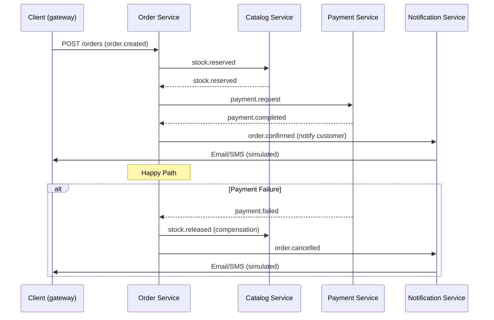

# Storefront Services

    

---

## Screenshots


---

## Overview

**Storefront Services** is a Kenyan‑market e‑commerce backend inspired by Jumia. It demonstrates a realistic microservice architecture with:
- **M‑Pesa** and **card** payment simulations (including a Daraja‑style STK push).
- **County‑aware** delivery tracking using Kenyan counties.
- Currency handling in **KES** (Kenyan Shilling) with `BigDecimal` precision.
- Full **Saga orchestration** for checkout, guaranteeing consistency across stock reservation, payment, and order confirmation.

---

## Architecture

```mermaid
graph LR
    G[API Gateway (8080)] --> U[User Service (8081)]
    G --> C[Catalog Service (8082)]
    G --> O[Order Service (8083)]
    G --> P[Payment Service (8084)]
    G --> N[Notification Service (8085)]
    subgraph Kafka Cluster
        K[(Kafka) ]
    end
    K --> U
    K --> C
    K --> O
    K --> P
    K --> N
    subgraph PostgreSQL
        DB[(PostgreSQL 16)]
    end
    U --> DB
    C --> DB
    O --> DB
    P --> DB
    N --> DB
```

---

## Checkout Saga



---

## Event Catalogue

| Topic | Producer | Consumers | Payload Summary |
|------|----------|-----------|-----------------|
| `order.created` | Order Service | Catalog Service, Order Service (for idempotency) | Order details (userId, addressId, items) |
| `stock.reserved` | Catalog Service | Order Service, Notification Service | OrderId, productId, quantity |
| `stock.reservation-failed` | Catalog Service | Order Service | OrderId, productId, reason |
| `payment.completed` | Payment Service | Order Service, Notification Service | OrderId, paymentId, amount, method |
| `payment.failed` | Payment Service | Order Service, Notification Service | OrderId, paymentId, reason |
| `stock.released` | Order Service | Catalog Service, Notification Service | OrderId, productId |
| `order.confirmed` | Order Service | Notification Service | OrderId, final status |
| `order.cancelled` | Order Service | Notification Service | OrderId, cancellation reason |
| `delivery.status-updated` | Notification Service | Order Service (optional) | OrderId, status, updatedAt |

**Outbox Pattern** – each service writes events to an `outbox_events` table inside the same transaction that updates business data. A scheduled poller (`OutboxPublisher`) reads pending rows and publishes them to Kafka, guaranteeing exactly‑once delivery.

**Retry & DLT** – Spring‑Kafka’s `RetryTopicConfiguration` creates `<topic>.retry‑<n>` topics (3 attempts, exponential back‑off) and a dead‑letter topic `<topic>.DLT` for messages that still fail. Idempotent consumers use a `processed_events` table to ignore duplicates.

---

## Tech Stack

| Category | Technology |
|----------|------------|
| Language | Java 21 |
| Framework | Spring Boot 3.3, Spring Cloud 2023.0, Spring Data JPA |
| Messaging | Apache Kafka (KRaft mode) |
| Resilience | Resilience4j (circuit breaker, retry, time‑limiter) |
| Testing | JUnit 5, Mockito, Testcontainers |
| Database | PostgreSQL 16 (Flyway migrations) |
| Containerisation | Docker, Docker Compose |
| Documentation | OpenAPI (springdoc‑openapi), Swagger UI |

| Service | Port | Responsibility | Database |
|--------|------|----------------|----------|
| API Gateway | 8080 | Routing, JWT validation, circuit breaking | – |
| User Service | 8081 | Register / login, JWT issuance, user management | Shared Postgres (user schema) |
| Catalog Service | 8082 | Products, categories, stock levels, reservation | Shared Postgres (catalog schema) |
| Order Service | 8083 | Cart checkout, saga orchestrator, order lifecycle | Shared Postgres (order schema) |
| Payment Service | 8084 | M‑Pesa STK push simulation, card payments, refunds | Shared Postgres (payment schema) |
| Notification Service | 8085 | Email/SMS simulation, delivery tracking, notifications | Shared Postgres (notification schema) |

---

## Quick Start

```bash
# Clone the repository
git clone https://github.com/yourusername/storefront-services.git && cd storefront-services

# Build and start all services with Docker Compose
docker compose up --build -d

# Verify everything is healthy (wait a few seconds)
watch -n 5 docker compose ps
```

### Run a Single Service Locally (example: User Service)

```bash
# Build the module
./mvnw -pl user-service -am clean package

# Run the service (uses Spring profile "default")
java -jar user-service/target/user-service-0.0.1-SNAPSHOT.jar
```

---

## API Examples (via Gateway)

```bash
# Register a new user
curl -X POST http://localhost:8080/api/auth/register \
     -H "Content-Type: application/json" \
     -d '{"email":"john@example.com","password":"Secret123"}'

# Login (returns JWT)
TOKEN=$(curl -s -X POST http://localhost:8080/api/auth/login \
     -H "Content-Type: application/json" \
     -d '{"email":"john@example.com","password":"Secret123"}' | jq -r .token)

# List products (public endpoint)
curl -s http://localhost:8080/api/products

# Create an order (requires JWT)
ORDER=$(cat <<EOF
{
  "userId":"$(uuidgen)",
  "addressId":"$(uuidgen)",
  "items":[{"productId":"$(uuidgen)","quantity":1,"price":100.00}]
}
EOF
)

curl -X POST http://localhost:8080/api/orders \
     -H "Authorization: Bearer $TOKEN" \
     -H "Content-Type: application/json" \
     -d "$ORDER"

# Track delivery timeline
curl -H "Authorization: Bearer $TOKEN" \
     http://localhost:8080/api/deliveries/<orderId>/timeline
```

---

## Resilience

Each route in the API Gateway is protected by a **Resilience4j circuit breaker** (`usersCB`, `catalogCB`, `ordersCB`, `paymentsCB`, `notificationsCB`). The fallback URI returns a JSON payload with HTTP 503.

**Demo a failure**:
```bash
# Stop the payment service container
docker compose stop payment-service

# The next payment request will hit the circuit breaker and receive the fallback response.
```

---

## Testing Strategy

- **Unit tests** for each module using JUnit 5 and Mockito.
- **Integration tests** with Testcontainers (Kafka, PostgreSQL) exercising the outbox, retry, and saga flows.
- **End‑to‑end smoke test** (`scripts/smoke-test.sh`) registers a user, creates an order, polls for confirmation, and displays the delivery timeline.

---

## Design Decisions & Trade‑offs

| Decision | Reasoning |
|----------|-----------|
| **Saga orchestration** (central OrderSaga) vs. choreography | Guarantees a clear single source of truth for order state, easier to reason about compensation, and fits the checkout flow where the order service coordinates multiple domains. |
| **Outbox pattern** | Prevents lost events during DB failures; decouples transaction commit from Kafka publishing. |
| **Per‑service database schema** | Enables independent evolution and scaling, while still using a single PostgreSQL instance for simplicity. |
| **Simulated Daraja (M‑Pesa) adapter** | Allows deterministic testing without external dependencies; can be swapped for the real Daraja API later. |
| **No Redis cache** | Keeps the stack minimal for the MVP; can be added later for rate‑limiting or caching. |

### Roadmap
- Replace the simulated M‑Pesa adapter with real Daraja integration.
- Add a Redis cache for rate‑limiting and session storage.
- Deploy to Kubernetes with Helm charts.
- Integrate OpenTelemetry for distributed tracing across services.
- Implement real email/SMS providers (e.g., Twilio, SendGrid).

---

## License

MIT License © 2024 Christopher Njihia

---

## Author

**Christopher Njihia** –  Full‑stack Java engineer, specialist in microservice architectures and Kenyan fintech ecosystems.
